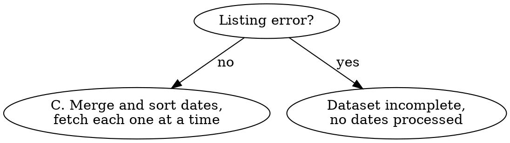

# Unicode art

Models write by tokens, not columns, so diagrams drawn by eye drift.
Fonts in web renderers also lack some glyphs and borrow them from other fonts with different widths.
Follow these rules, then run the checker.

## Pick the right format first

| Content | Use |
|---|---|
| Rows and columns of values | Markdown table, never a box |
| Steps or data flow | Flow chart generated with phart (see below) |
| Files or hierarchy | Tree with `├──` and `└──` |
| Anything that needs more than about 70 columns | Split it, or use a table or a list |

## Flow charts: generate with phart

Models write tokens, not columns, so boxes drawn by hand drift out of line.
phart lays out the boxes, so the edges line up by construction.

To make a flow chart:

1. Write a small DOT file in `~/.cache/opencode-tmp/`. Use `\n` for line breaks in labels, and keep each label line under about 30 characters so the diagram stays under 80 columns.
2. Run phart from a directory other than the DOT file's directory, and pass the DOT path:

```bash
uvx --python 3.15 --with pydot phart --bboxes --uniform --charset unicode --edge-arrow-style ascii --labels --layer-spacing 2 /path/to/flow.dot
```

3. Paste the output into a fenced `text` block.

Always pass `--edge-arrow-style ascii` (the default can print `↓`, which this skill bans) and `--labels` (without it, nodes show only their ids). Edge labels such as yes or no work with `[label="yes"]`.

Example DOT file:



Rendered output:

```text
                  ┌───────────────────────────────┐
                  │        Listing error?         │
                  └───────────────────────────────┘
                ┌───────no────────┴───────yes────────┐
                v                                    v
┌───────────────────────────────┐    ┌───────────────────────────────┐
│   C. Merge and sort dates,    │    │      Dataset incomplete,      │
│   fetch each one at a time    │    │      no dates processed       │
└───────────────────────────────┘    └───────────────────────────────┘
```

Limits:

- phart only lays out graphs. Trees, tables, and side-by-side before/after layouts stay hand-written (tables for data, short trees), or you can join two phart outputs with `paste`.
- Box width follows the longest label line, so keep labels short.
- Tested with phart 2.1.0 via uvx. `--node-label-width` was not available there, so wrap labels by hand with `\n`.
- If phart is unavailable, draw by hand, then run the checker.

## Glyphs

| Allowed | Do not use in web-rendered content |
|---|---|
| `─ │ ┌ ┐ └ ┘ ├ ┤ ┬ ┴ ┼` | Double lines `═ ║ ╔ ╗ ╚ ╝` |
| ASCII arrows `-->` `<--` `v` `^` | Heavy lines `━ ┃ ┏` |
| Plain ASCII text | `▶ ▼ ◀ ▲ ➤ → ←`, `…`, emoji |

In the opencode TUI the same rules apply. Emoji are fine around a diagram, never inside one.

In Jira, use ASCII only (`.` `'` `-` `|` for boxes): its code font lacks box-drawing glyphs, so they drift.
Avoid `+` in Jira too, even in code blocks: `+text+` becomes underline.

## Layout rules

- Pad every line of a box with spaces so the right edge is in the same column on every line.
- Never truncate text (like `..trigger`) to make it fit. Widen the box or move the label outside.
- Keep one label per line inside a box. Put long notes below the diagram.
- Do not put `├──` or `└──` tree connectors inside a box next to text, because they render at inconsistent widths and misalign the right edge. Use indented text or `-` bullets inside boxes. Standalone trees outside a box are fine.
- Line up vertical arrows under the exact column of the box they point to.
- Always put the diagram in a fenced code block so the renderer uses a monospace font.
- If you're showing a before/after scenario, put the diagrams side by side so it's easier for humans to see the differences.

## Check before posting

Write the diagram to a temp file and run:

```bash
~/.config/opencode/skills/unicode-art/check_art.py /path/to/diagram.txt
```

Or pipe it with `-`. Use `--max-width N` to change the 80-column limit.
Fix every reported line and rerun until it prints `OK`.
The checker flags lines that end a box at a different column than their neighbors, risky glyphs, and lines that are too wide.

To check a whole Markdown document, run `check_art.py doc.md`. It checks each fenced block that has box-drawing or risky glyphs and reports line numbers in the Markdown file. Fence a deliberately bad example as `text bad` to skip it.

The checker is the final gate for glyphs, width, and hand-drawn art. It does not make phart output line up; phart does that.

## Example

Bad (table inside a box, double lines, truncated text):

```text bad
╔═════════════════════════════╗
║ field           java   python ║
║ publish_stage   konflux ..trigger║
╚═════════════════════════════╝
```

Good (a table):

| Field | java | python |
|---|---|---|
| publish_stage | konflux_import | trigger |

Good (hand-drawn flow, only when phart is unavailable):

```
┌──────────────────┐     ┌──────────────────────┐
│ resolve_ecosystem│ --> │ stage_capabilities() │
└──────────────────┘     └──────────────────────┘
                                    |
                                    v
                         ┌──────────────────────┐
                         │ registry lookup      │
                         └──────────────────────┘
```
